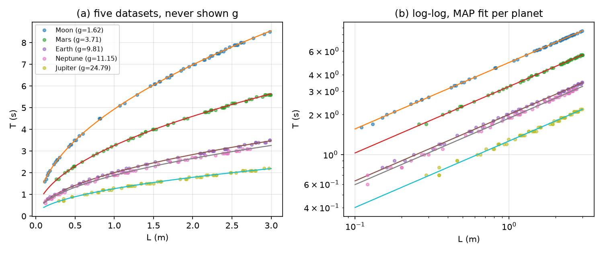
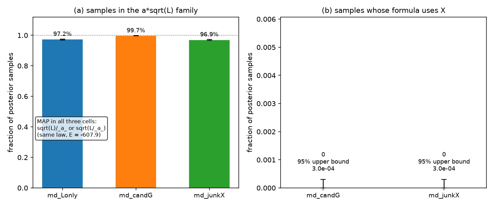
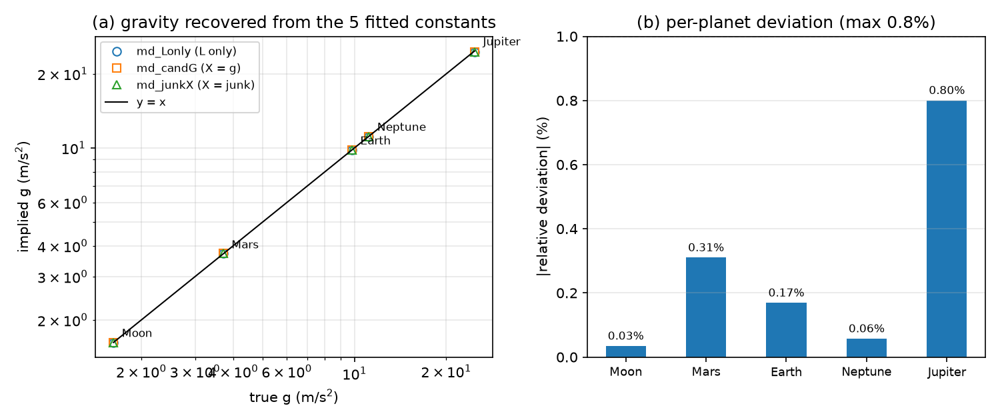
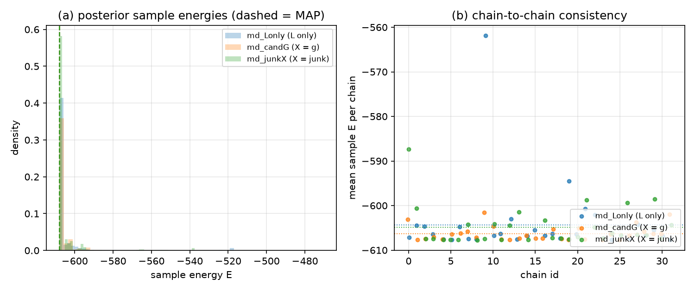
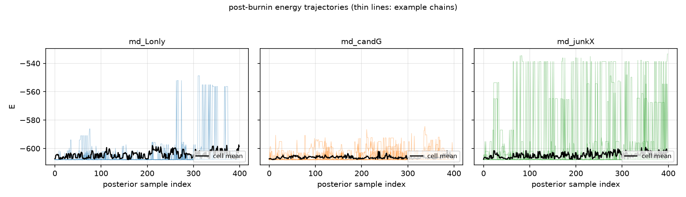
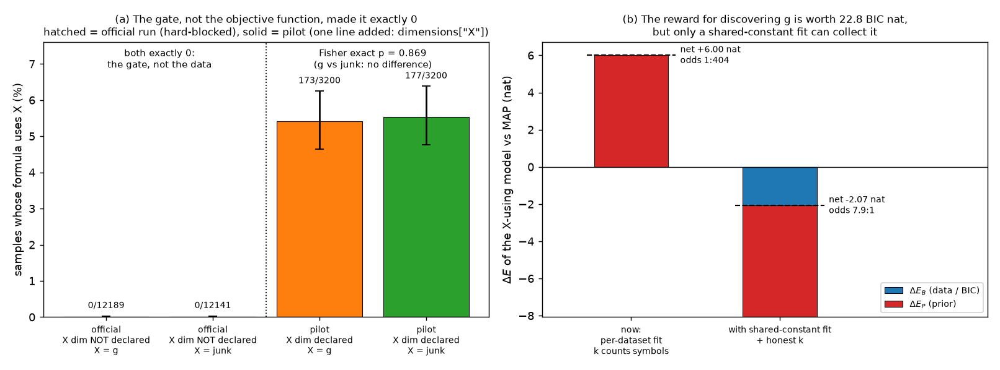

# 多数据集单摆实验报告：BMS 能否发现"共同公式"与隐藏变量

- 日期：2026-10-18（当晚修订）
- 实验脚本：`experiments/pendulum/multidataset/multidataset_planets.py`
- 复核探针：`temp/md_diag/probe1..probe9*.py`（附录 A 列出复现命令）
- 反事实试跑：`experiments/pendulum/multidataset/multidataset_xdim_pilot.py`
- 集群作业：`bms-mdata` 38351（采样）、`bms-mdana` 38371（汇总）、`bms-test1` 38350（单测复查）
- 数据与产物：集群 `~/bms_runs/multidataset_pt20/`；本地存档 `temp/md_pt20/`；
  试跑产物 `experiments/pendulum/multidataset/multidataset_runs/xdim_pilot/`
- 本报告插图：`multidataset_report/fig1..fig7.png`

## 修订说明

原版把问题 (b) 的 `0/12,189` 归因于"BIC 的参数量 k 按表达式计、不奖励跨数据集
常数塌缩"。逐行核对代码并插桩实测后查明：**那个 0 不是目标函数的统计结果，而是
量纲宪法硬闸门的确定性结果**——实验把 X 放进了 `variables`，却没有在 `dimensions`
里声明 X 的量纲，于是任何含 X 的表达式在提议阶段就被判 `dE = +inf`、接受概率
恒等于 0。实测 60,000 步里有 17,390 次提议含 X，通过闸门 0 次，理由唯一。

因此原版第 5 节的机制**真实存在但不是这次 0% 的原因**：它属于第二层。这次实验
实际上没有检验到问题 (b)。本版把三层原因拆开，每层单独给实测数字，并补一次
反事实试跑（只补 X 的量纲声明，其余逐位一致）来分离各层。

## 摘要

只给 5 份独立数据集（每份只有 L 与 T，从不告知 g 的存在），BMS 能发现这 5 份
数据服从同一条公式 a·√L，并把每颗星球的重力加速度从各自拟合常数中反推回来
（最大相对偏差 0.8%）——**问题 (a) 成立，且不受本次修订影响**。

问题 (b) 的 `0/12,189` 有三层原因，逐层实测：

1. **硬闸门（这次的直接原因，确定性）**：X 没有声明量纲，量纲宪法把含 X 的树判为
   结构性非法，接受概率恒为 0，与温度无关——20 温度回火救不了硬约束。
2. **不可辨识（把闸门打开后仍然失败的原因）**：X 在每份数据内部是常数，而每份数据
   都有一个自由常数，所以任何 X 依赖都能被完全吸收。实测含 X 与不含 X 的模型
   逐数据集 SSE 差 ≤ 4.7×10⁻¹⁶、BIC 逐位相同，含 X 的样本 100% 仍落在 a·√L 族内。
3. **奖励入口不存在**：拟合按数据集各自独立进行，"5 个常数塌成 1 个"在当前代码里
   根本无法表示，所以 k 无论怎么改都拿不到那份奖品。诚实记账下这份奖品值
   22.8 BIC nat，扣掉拟合变差与先验代价后净剩 2.07 E nat（约 8:1）——**5 个数据集
   偏少**。

反事实试跑（只补 X 的量纲声明，8 链/格、3200 样本/格）：X 使用率从 0 变成
**5.41% [4.65, 6.25]**（X = 真 g）与 **5.53% [4.76, 6.38]**（X = 随机数），
Fisher 精确检验 OR = 0.976、p = 0.869，两格 MAP 同为 `sqrt((L / _a_))`、E 同为
-607.9386。即：闸门是唯一让 0 变成非 0 的因素，而"X 是物理量还是随机数"这件事
**在打开闸门之后依然完全不可区分**。

下一步不是改 k 的计数，而是先补声明、再改拟合通道（共享参数池），并把数据集数
提到 10 以上。

## 1. 实验问题

模拟一个"多实验、同物理"的场景：五颗星球（月球、火星、地球、海王星、木星）
各测 60 个单摆数据点 (L, T)。分析者只拿到 5 份独立数据表，**不知道 g 的
存在**。问贝叶斯机器科学家（BMS）能否：

- **(a) 发现这 5 份数据服从同一条公式**；
- **(b) 发现这 5 个拟合常数背后是同一个隐藏变量 g**。

与 `../known_g/pendulum.py` 多星球实验的本质区别：那里把 5 颗星球合并成一张表并明确
把 g 作为输入列，"只有一条公式"是数据格式规定的；本实验走 `Tree` 的多数据
集通道，表达式只有一条、常数按数据集各自拟合，"是否存在共同公式"是 BMS
自己要付账的假设。

## 2. 实验设计

### 2.1 数据生成

- 真律 T = 2π√(L/g)，5 颗星球 g = 1.62 / 3.71 / 9.81 / 11.15 / 24.79 m/s²。
- 每星球 N = 60 点，L_true ~ U(0.1, 3.0) m。
- 仪器分辨率模型（沿用 known_g/pendulum.py）：L 按 0.01 m 取整，T 按 0.1 s 取整
  （图 1 中 T 的阶梯量化清晰可见）。
- 数据种子 20261018（固定）。三格共用同一批 (L, T)，只改 X 列。



### 2.2 三格设计与判读逻辑

| 格 | 变量 | X 列 | 回答什么 |
|---|---|---|---|
| md_Lonly | L | 无 | 基准：能否收敛到 a·√L，5 个常数是否各自反推 g |
| md_candG | L, X | 该星球真 g（不说明） | 问题 (b)：能否发现隐藏变量 |
| md_junkX | L, X | 每星球一个随机数（0.5–5.0） | 负对照：X 与物理无关，且恒定值可被常数完全吸收 |

**负对照必不可少**（详见 `prompt.md` 与脚本 docstring）：若只跑 md_candG 得
到 0%，无法区分"发现不了"和"发现了但目标函数没奖励"。两格同跑且结果无差别，
才能下后者的结论。

> 本次修订补一条：负对照也**不能**区分"发现不了"和"根本没让它试"。三格同跑之外，
> 还需要一个正向对照——一个已知会被接受的 X 用法——才能证明 X 这条通道是通的。
> 第 6.4 节的反事实试跑就是这个正向对照。

### 2.3 两处记账事实（原版此节已改写）

**(1) k 按"表达式里的参数记号"计，且被每数据集重复收取一次。**
`core/energy.py:120-128`：

```python
parameters = set([p.value for p in self.ets[0] if p.value in self.parameters]
                 + self.fixed_parameters)
k = 1 + len(parameters)          # 本实验恒为 1 + 1 = 2
BIC = 0.
for ds in self.y:
    n = len(self.y[ds])
    BIC += (k - n) * np.log(n) + n * (np.log(2π) + log(sse[ds]) + 1)
```

k 的**取值**与数据集数无关（恒为 2），但 `(k-n)ln n` 在 `for ds` 里累加 5 次，
所以 k 实际上被收了 5 遍。真正的漏洞不在"收几遍"，而在**k 数的是记号个数（1 个
`_a_`），而模型实际有 5 个自由数**（每数据集一个 `_a_`，见 `core/energy.py:51-78`
的逐数据集 `curve_fit`）。少收的账是 4·ln(60)·5 = 81.9 BIC nat = 40.9 E nat。

**(2) 拟合是逐数据集独立的，"共享常数"在当前代码里无法表示。**
`core/tree_base.py:137-142` 把 `par_values` 建成按数据集索引的字典，
`core/energy.py:51-78` 在 `for ds in self.x` 里对每份数据各调一次 `curve_fit`。
把 X 写进公式**不会减少被拟合的数字个数**——`_a_` 照样按数据集各拟合一份。
所以原版说的"用 X 把 5 个常数塌成 1 个并不减少 k"，准确的版本是：
**那个"塌成 1 个"的模型在代码里根本不存在**。

推论：任何只在 k 的**计数**上做文章的方案都不可能产生奖励（第 6.3、6.5 节）。

### 2.4 采样配置与统计口径

- 采样器：20 温度并行回火（`core/parallel.py`，ladder 1.04^k，最高 2.107），
  与 known_g/pendulum.py 历史同预算：burnin 4000 / thin 10 / samples 400，max_size 50。
- 先验：bms_wiki_nv13_np13。
- 正式规模：3 格 × 32 链 = 96 链（计划），40 核节点。
- 共同公式族判定（`sqrtL_coefficients`）：对逐样本 (公式, 各数据集常数)，
  若公式在每份数据上都正比于 √L（相对离散度 ≤ 1e-3），记该样本"过形状关"。
  只有先过形状关才谈反推 g，避免把 (2π/c)² 套到错误形状上产生荒谬假数。
- 区间：比例量的 95% 区间一律用 Clopper–Pearson（beta 精确法），对 0 事件
  给出上界而非点估计。
- 逐样本图与派生统计由 `multidataset_report_figs.py` 重新计算，与官方
  `analyze()` 输出逐格对账一致（n 与 family_frac 完全吻合）。

## 3. 执行记录

| 作业 | 内容 | 结果 |
|---|---|---|
| 38333 bms-test | 集群全量测试 | 145 通过，1 失败（见 8.3） |
| 38350 bms-test1 | 单测复查 | 该失败集群上确定性复现 |
| 38351 bms-mdata | 正式跑量 96 链 | 91 链完整完成；2 任务丢失、3 链滞留，主动 scancel（见 8.1/8.2） |
| 38371 bms-mdana | `--analyze-only` 汇总 | 从 94 份 trace 重算 summary.json |
| 本地复核 | probe1/2/3/5/6 插桩与反事实计算 | 定位硬闸门；量化 ΔEB=0、ΔEP=+6.002 |
| 本地试跑 | `multidataset_xdim_pilot.py`，16 链 1706 s | 补声明量纲后 X 使用率 5.41% / 5.53% |

环境等价性：同步前做了逐目录 checksum 对比，集群工作区与本仓库逐文件一致。
运行期间环境诊断脚本留在集群 `~/bms_runs/_diag/`。本地复核与试跑环境为
py3.12.14 / numpy 2.5.3 / scipy 1.18.1 / sympy 1.14.0 / pandas 3.0.6。

## 4. 结果

### 4.1 总表

| 格 | 链数 | 样本数 | 共同公式族占比 (CP95) | X 使用率 (CP95) | MAP | 反推 g 最大偏差 |
|---|---|---|---|---|---|---|
| md_Lonly | 32 | 12,743 | 97.2% [96.9, 97.5] | — | `sqrt(L/_a_)` | 0.80% |
| md_candG | 31 | 12,189 | 99.7% [99.6, 99.8] | **0 [0, 3.0e-4]** | `sqrt(L)/_a_` | 0.80% |
| md_junkX | 31 | 12,141 | 96.9% [96.6, 97.2] | **0 [0, 3.0e-4]** | `sqrt(L/_a_)` | 0.80% |
| *试跑* md_candG + X 量纲 | *8* | *3,200* | *99.2%* | ***5.41% [4.65, 6.25]*** | *`sqrt(L/_a_)`* | *0.80%* |
| *试跑* md_junkX + X 量纲 | *8* | *3,200* | *99.7%* | ***5.53% [4.76, 6.38]*** | *`sqrt(L/_a_)`* | *0.80%* |

三格 MAP 是同一条律的两种等价写法（_a_ 重参数化相差一个平方），能量同为
E = -607.9386，逐链尺寸中位数都是 3 个算子。96.9–99.7% 的后验样本（视格而定）
落在 a·√L 族内（图 2a、图 5）。补声明量纲后 MAP 与 E **一位未变**。



### 4.2 问题 (a)：共同公式——能

- 逐样本形状判定：97.2% / 99.7% / 96.9%（图 2a），每条完整链的链内族占比
  中位数 = 100%（附录 B），不是个别链的偶然。
- 公式复杂度：三格 80–82% 的样本是 1–3 算子的极小表达式（MAP 即 3 算子），
  所有链的中位复杂度 = 3（图 5）。后验集中在一个极小的模型上。
- 给出真 g 作候选列（md_candG）不干扰收敛，反而族占比最高（99.7%）——
  多一个无关列没有制造可观测的负担。**修订注**：这个"没有负担"是因为该列被
  闸门整体挡在搜索空间之外，不是因为采样器消化了它。

### 4.3 问题 (b)：这次实验没有检验到它

- md_candG：0/12,189 个样本的公式含 X；md_junkX：0/12,141。
- 对全部 94 份迹线做词法扫描（`(?<![A-Za-z_])X(?![A-Za-z_])`），命中 0 行。
- 插桩实测（第 6.1 节）：60,000 步中 52,842 次宪法检查、17,390 次候选树含 X、
  通过 0 次。
- 所以 `0` 是**闸门造成的确定性结果**，不是"试了但没被奖励"。原版据此推出的
  "目标函数层面不可达"这一因果链，在本次数据上不成立。

### 4.4 g 的反推

MAP 过形状关后，由各数据集常数反推 g = (2π/c)²：

| 数据集 | 星球 | 反推 g | 真值 | 相对偏差 | 拟合出的 _a_ | g/4π² |
|---|---|---|---|---|---|---|
| d0 | Moon | 1.619 | 1.62 | 0.03% | 0.041021 | 0.041035 |
| d1 | Mars | 3.722 | 3.71 | 0.31% | 0.094267 | 0.093975 |
| d2 | Earth | 9.793 | 9.81 | 0.17% | 0.248070 | 0.248490 |
| d3 | Neptune | 11.144 | 11.15 | 0.06% | 0.282271 | 0.282433 |
| d4 | Jupiter | 24.592 | 24.79 | 0.80% | 0.622913 | 0.627938 |



三格给出的反推值到打印精度完全相同（同一 MAP 律、同一批数据）。偏差主要
来自 T 的 0.1 s 量化（短周期点量化误差大），木星档最大 0.8%。

残差已经踩到量化底：5 份数据合并 σ̂ = √(SSE/N) = 0.028812 s，而 T 按 0.1 s
取整的理论标准差是 0.1/√12 = 0.028868 s。**模型 A 已经把能解释的都解释完了**，
这条事实在第 6.2 节是关键：没有剩余结构可供隐藏变量去解释。

### 4.5 收敛与稳健性



三格样本能量分布几乎重合（图 4a），尖峰在 E ≈ -608；逐链均值绝大多数落在
-606 ± 2（图 4b）。少数链（含被截断的部分链）处于更高能量平台，是 8.2 长尾
事件的直接体现。图 6 显示绝大多数链在 burnin 后即贴底平稳，cell mean 稳定。



## 5. 从合成数据到表达式树：一条样本是怎么算出来的

这一节按数据流顺序走一遍代码，每一处都标出行号。目的是让第 6 节的三层原因
各自落在具体的行上。

### 5.1 合成数据：X 在份内恒定（这一条决定了后面一切）

`experiments/pendulum/multidataset/multidataset_planets.py:94-112`：

```python
rng = np.random.default_rng(seed)                  # 97
junk = rng.uniform(0.5, 5.0, len(PLANETS))         # 98  先抽，保证三格 L/T 逐位相同
for i, (name, gv) in enumerate(PLANETS.items()):   # 100
    L_true = rng.uniform(*L_RANGE, N_PER)          # 101
    L_obs  = np.round(L_true / DL) * DL            # 102  0.01 m 分辨率
    T_obs  = np.round(TWO_PI*np.sqrt(L_true/gv)/DT)*DT   # 103  0.1 s 分辨率
    row = {'L': L_obs}                             # 104
    if cfg['offer'] == 'g':   row['X'] = np.full(N_PER, gv)      # 106
    elif cfg['offer'] == 'junk': row['X'] = np.full(N_PER, junk[i])  # 108
```

`np.full` 是关键：X 在一份数据内部是**常数**，只在数据集之间变化（第 106、108 行）。
物理上这正是"g 是隐藏变量"的构造方式，但它同时造成了第 6.2 节的不可辨识性。

### 5.2 变量表与量纲表：X 进了前者，没进后者

```python
DIMS = {'L': (1, 0, 0, 0, 0, 0, 0)}                # 72   ← 只有 L
SCENARIOS = {                                      # 74-78
    'md_Lonly': dict(variables=['L'],      offer='none'),
    'md_candG': dict(variables=['L', 'X'], offer='g'),   # ← X 在这里出现
    'md_junkX': dict(variables=['L', 'X'], offer='junk'),
}
```

7 元组是 SI 基本量纲 (L, M, T, I, Θ, N, J) 的指数。**第 72 行没有 X 的条目**，
而第 76-77 行把 X 放进了变量表。这一处不一致就是第 6.1 节的全部原因。

### 5.3 建树与先验

`multidataset_planets.py:119-148`：

```python
tree_kwargs = dict(
    variables=variables, parameters=['a'],         # 133-134  → 内部改写成 '_a_'
    dimensions=DIMS, constitutions=[DimensionalConstitution()],   # 135
    x=x, y=y, prior_par=prior_par, max_size=cfg['max_size'])      # 136
sampler = Parallel(cfg['Ts'], **tree_kwargs)       # 140
sampler.mcmc(..., burnin=4000, thin=10, samples=400)   # 144-146
```

`core/tree_base.py` 里几个决定后续行为的初始化：

| 行 | 内容 | 后果 |
|---|---|---|
| 59-62 | `parameters=['a']` → `['_a_']` | 只有 `_x_` 形式的叶子会被拟合 |
| 64-67 | `root = Node(choice(variables+parameters))` | 起手树有 1/3 概率就是 `X`；`__init__` 不做宪法检查 |
| 104-117 | x 是 dict → 走多数据集通道 | `self.x`/`self.y` 是 5 键字典 |
| 137-142 | `par_values = {ds: {p: 1.0}}` | **每数据集一份常数**，第 6.3 节的根 |
| 146-152 | `dimensions` / `target_dim=None` / `constitutions` | 只查内部齐次性，不锚定根量纲 |
| 353-362 | `et_space[0] = [[v,[]] for v in variables+parameters]` | 叶子候选 = ['L','X','_a_']，X 占 1/3 |

先验：`prior/registry.py:221` 的 `DEFAULT_PRIOR='bms_wiki_nv13_np13'` →
`:178-190` 的 spec → `:51-71` 的数值表，出处是上游
`Prior/final_prior_param_sq.named_equations.nv13.np13...dat`（13 变量 / 13 参数
语料的矩匹配拟合）。数学形式 `-log p(f) = Σ_o [a_o·n_o + b_o·n_o²]`，在
`core/energy.py:144-152` 累加成 EP，本先验只有一个二阶项 `Nopi2_* = 1.0`。

**EP 只数算子，不看叶子是谁**——所以"多一个 X 叶子"本身不花钱，花钱的是为了
把 X 接进式子而多出来的算子。用到的数值：

| 算子 | Nopi（nat） | 算子 | Nopi（nat） |
|---|---|---|---|
| sqrt | 4.760687 | + | 5.808164 |
| / | 5.912206 | * | 5.002214（另有 Nopi2 = 1.0） |
| log | 4.745957 | ** | 6.473443 |
| exp | 4.768665 | pow2 | 3.301735 |

MAP `sqrt((L / _a_))` 的 EP = 4.760687 + 5.912206 = **10.672893**。

### 5.4 一条样本的完整数值账

以正式跑量的 MAP 为例，把 `core/energy.py` 的账逐项算开：

| 步骤 | 代码 | 数值 |
|---|---|---|
| 树 | `sqrt → / → (L, _a_)` | 3 个节点，nops = {sqrt:1, /:1} |
| 先验 EP | `energy.py:144-152` | 10.672893 |
| 逐数据集拟合 `_a_` | `energy.py:51-78`（5 次 `curve_fit`） | 0.041021 / 0.094267 / 0.248070 / 0.282271 / 0.622913 |
| 逐数据集 SSE | `energy.py:87-103` | 5.047e-2 / 4.571e-2 / 4.443e-2 / 5.812e-2 / 5.031e-2 |
| k | `energy.py:120-124` | 1 + 1 = **2** |
| 惩罚项 Σ(k-n)ln n | `energy.py:128` | 5×(2-60)×ln60 = **-1187.360** |
| 常数项 Σn(ln2π+1) | 同上 | 300×2.837877 = **+851.363** |
| 数据项 60·Σln SSE | 同上 | **-901.226** |
| BIC | | **-1237.223** |
| EB = BIC/2 | `energy.py:140` | **-618.6115** |
| E = EB + EP | `energy.py:161` | **-607.9386** ✓ 与 summary.json 一致 |

### 5.5 提议 → 闸门 → 接受概率

一步 MCMC（`core/mcmc.py:17-148`）按 `topDice` 分三类：根替换（p=0.05）、
长程换值（p=0.45）、元树替换（p=0.50）。三类都先算 dE，再判接受。

**闸门**在 `core/proposal.py` 的三处，写法完全一致（`dE_et` 为例，:255-268）：

```python
gate_failed = False
if hasattr(self, 'check_constitution') and not self.check_constitution():
    gate_failed = True                      # 257-259
elif self.update_representative(verbose=verbose) == -1:
    gate_failed = True                      # 260-261
if gate_failed:
    self.et_replace(added, old, ...)        # 265  回滚
    ...
    return np.inf, np.inf, np.inf, ..., nif, nfi   # 268
```

同样的三行出现在 `dE_lr:347-365`、`dE_rr:449-462`（剪根）与 `:520-533`（换根）。
`check_constitution` 在 `experts/base.py:31-37`：任一宪法失败即 False。

**量纲宪法**对叶子的处理在 `experts/constitution/dimensional.py:314-338`：

```python
if val in known_dims:      return [DimExpr(const=Fraction(d)) for d in dim_tuple]  # 316-319
elif val in param_set:     return [DimExpr(_coeffs=((val, 1),)) ...]              # 320-322
elif _numeric_value(val):  return [DimExpr() ...]        # 323-326  字面数字无量纲
else:
    unknowns.append(DimensionFailure(dim_index=-1, dim_name='*',                  # 328-337
        description="leaf 'X' has no declared dimension and is not a fitted "
                    "parameter: add dimensions['X'] = (...) or declare it as a parameter"))
```

`known_dims` 就是 `tree.dimensions`（`:649`），本实验只有 L；`param_set` 只有
`_a_`（`:651-657`）。X 三个分支都不落，进 `unknowns`。这些 unknowns 经
`solve_constraints(..., extra_failures=unknowns)`（`:600`）变成
`failures`（`:485`），最终 `is_valid = len(failures) == 0` → **False**（`:552-556`）。

失败信息本身就把修法写出来了：`add dimensions['X'] = (...)`。
`dimensional.py:306-309` 的注释明确这是设计意图——未知叶子"不被静默当作无量纲"；
README:62/193 也把量纲不一致描述为"无限大惩罚，不经后续评估直接淘汰"。
**所以这不是宪法走样，是实验少给了一个输入。**

**接受概率**（`core/mcmc.py`）——inf 进去，0 出来：

| 移动 | 行 | 表达式 | dE=inf 时 |
|---|---|---|---|
| 剪根 | 28-32 | `exp(-dEB/BT - dEP/PT)/num_rr` | `exp(-inf)=0.0` |
| 换根 | 47-53 | `num_rr * exp(-dEB/BT - dEP/PT)` | `0.0` |
| 长程 | 81 | `exp(-dEB/BT - dEP/PT)` | `0.0` |
| 元树 | 130-132 | `nif·omegai·sf·exp(...)/(nfi·omegaf·si)` | `0.0` |

四处都是 `dice < paccept`（34、55、87、138 行），`dice = random() ∈ [0,1)`，
`dice < 0.0` 恒假 → **恒拒绝**。注意 `np.exp(-inf)` 返回 0.0 而不抛异常，所以
`mcmc.py:82-84` 与 `:133-135` 的 `except` 兜底分支不会触发。

**BT 只出现在 inf 的除数上**：`-inf/BT` 对任何有限 BT 仍是 `-inf`。本实验的阶梯
最高温 2.107，`anneal()` 的 factor=5 也乘不出有限值。所以
**并行回火对硬闸门完全无效**——它能救"采样不可达"，救不了"结构不可达"。
（这一点与 `project-pendulum-powerlaw-blocker` 记录的"先判定结构不可达还是采样
不可达"是同一个教训。）

### 5.6 迹线与统计

`core/parallel.py:148-166` 只写 BT=1 副本，每行
`[s, bic, E, E_str, str(tree), par_values]`；副本间共享 `fit_par` 与
`representative`（`:43-47`），交换比只用 EB（`:76-78`，因各副本 PT 相同而严格相消）。
`multidataset_planets.py:229-231` 在每行上做 `uses_var(formula,'X')` 与形状判定。
链里既然没有 X，`n_with_X` 恒为 0。

## 6. (b) 为什么不成立：三层原因，逐层实测

### 6.1 第一层：硬闸门——0% 是确定性结果

`temp/md_diag/probe2_gate_stats.py` 给 `DimensionalConstitution.check` 插桩，
按正式配置（20 温度、max_size 50、同数据同先验）跑 3000 步/格：

| 量 | md_candG | md_junkX |
|---|---|---|
| MCMC 步（3000 步 × 20 副本） | 60,000 | 60,000 |
| 宪法检查次数 | 52,842 | 52,842 |
| 其中候选树含 X | **17,390（32.9%）** | **17,390（32.9%）** |
| 通过宪法 | **0** | **0** |
| 拒绝理由 | 唯一：`leaf 'X' has no declared dimension...` | 同 |
| BT=1 写出样本含 X | 0 / 200 | 0 / 200 |

两格的检查次数与含 X 提议数**逐位相同**，这本身就是证据：闸门在读取任何数据之前
就开火了，X 那一列的数值（真 g 还是随机数）从未参与判定。

从 MAP 出发的单步提议（`probe5_one_move.py`，两种配置对照）：

| 提议 | as-run（X 未声明） | 补声明 X:(1,0,-2,0,0,0,0) |
|---|---|---|
| 叶子 `_a_` → `X`（得 `sqrt((L/X))`，无自由常数） | dE = inf，paccept = 0 | dEB = +1332.11，paccept = 0 |
| 叶子 `L` → `X` | dE = inf，paccept = 0 | dEB = +1038.80，paccept = 0 |
| `_a_` → `(X * _a_)`（得 `sqrt((L/(X*_a_)))`） | dE = inf，paccept = 0 | **dEB = -0.0000，dEP = +6.0022，paccept = 1.24e-3** |
| `_a_` → `(_a_ / X)` | dE = inf，paccept = 0 | **dEB = 0.0000，dEP = +5.9122，paccept = 2.71e-3** |

**"临门一脚"确实只有一步**：第 3、4 行那两种一步之遥的写法，BIC 与 MAP 逐位相同
（dEB = 0），代价只有 6 nat 的先验。但 as-run 下它们是 inf，链永远走不过去。

94 份正式迹线的词法扫描：含 X 的行数 = **0**。

**为什么原版第 5 节的解释在这里不成立（数量级对不上）**：若 X 只是"可达但不被
奖励"，最小的竞争者应占后验 e^{-6.002} = 0.25%，12,189 个样本期望 ~30 个；
而试跑实测的平衡占比是 5.4%（第 6.4 节），期望 ~660 个。即使把有效样本量按
名义值的 1/100 折，31 条独立链下期望仍有 ~6.6 个，P(观测到 0) ≈ 0.14%。
观测到的 CP95 上界 3.0×10⁻⁴ 比 0.25% 低 8 倍——"可达但不被奖励"这个假设本身
就被数据排除了，不需要插桩也能看出来；插桩只是把机制钉死。

### 6.2 第二层：X 份内恒定 ⇒ 数学上不可辨识

把闸门打开（声明 X 的量纲）后，`probe3_identifiability.py` 逐数据集对比：

| ds | 星球 | X 列（=g，份内恒定） | `_a_`（不含 X） | `_a_`（含 X） | SSE 不含 X | SSE 含 X | ΔSSE |
|---|---|---|---|---|---|---|---|
| d0 | Moon | 1.62 | 0.041021 | 6.284269 | 5.04698945e-02 | 5.04698945e-02 | +4.7e-16 |
| d1 | Mars | 3.71 | 0.094267 | 6.273469 | 4.57078262e-02 | 4.57078262e-02 | +9.7e-17 |
| d2 | Earth | 9.81 | 0.248070 | 6.288499 | 4.44316411e-02 | 4.44316411e-02 | -1.6e-16 |
| d3 | Neptune | 11.15 | 0.282271 | 6.284985 | 5.81170999e-02 | 5.81170999e-02 | -6.3e-17 |
| d4 | Jupiter | 24.79 | 0.622913 | 6.308477 | 5.03139724e-02 | 5.03139724e-02 | -5.6e-17 |

模型级：

| 公式 | k | BIC | EB | EP | E | E-E_MAP |
|---|---|---|---|---|---|---|
| `sqrt((L / _a_))`（MAP） | 2 | -1237.2229 | -618.6115 | 10.6729 | -607.9386 | 0 |
| `(sqrt(L) / _a_)` | 2 | -1237.2229 | -618.6115 | 10.6729 | -607.9386 | 0 |
| `(sqrt((L / X)) * _a_)` | 2 | -1237.2229 | -618.6115 | 16.6751 | -601.9364 | **+6.0022** |
| `sqrt(((L / X) / _a_))` | 2 | -1237.2229 | -618.6115 | 16.5851 | -602.0264 | +5.9122 |
| `(sqrt((L / _a_)) * (X / X))` | 2 | -1237.2229 | -618.6115 | 22.5873 | -596.0241 | +11.9144 |

ΔSSE 在浮点噪声量级（≤4.7×10⁻¹⁶），BIC 到小数点后 4 位完全相同。原因很干脆：
X 在份内是常数，`sqrt(L/X)·a` 在每份数据上就是 `sqrt(L)·(a/√X)`，而 a 本来就按
数据集自由拟合——**X 的任何函数都被 a 吸收**。所以含 X 的模型是严格的结构冗余：
拟合一分没改善，k 一分没减少，只多付算子先验。

最后一行是这件事最直白的证据：`(X / X)` 恒等于 1，SSE 与 MAP 逐位相同，只多花
11.9 nat。**在当前的记账下，"提到 X"和"用 X 做功"完全无法区分**——这也直接说明
原版第 5 节方案 A 是可被套利的（第 6.5 节）。

**证据其实就在拟合输出里，只是没人读它**：把 X 写进公式后，5 个数据集各自拟合的
常数变成 `[6.2843, 6.2735, 6.2885, 6.2850, 6.3085]`，变异系数 **0.182%**，均值
6.2879（2π = 6.283185，偏 0.075%）；不含 X 时这 5 个数是 0.0410~0.6229，跨
**15.2 倍**。"五个常数彼此相等且等于 2π"正是科学家用来断定 X 就是 g 的那条证据。
但 `core/energy.py` 的能量函数只读 SSE 和算子计数，**从不读跨数据集常数之间的
一致性**——这个量在目标函数里没有任何入口。

### 6.3 第三层：奖励入口不存在，而且奖品没那么大

要拿奖励，必须先有一个"常数跨数据集共享"的模型。当前代码里没有：
`par_values` 是按数据集索引的字典（`tree_base.py:137-142`），拟合在
`for ds in self.x` 里逐份独立做（`energy.py:51-78`）。`fixed_term` /
`fixed_parameters` 走的也是同一个 `par_values`，同样是每数据集一份。

假设把拟合改成共享（原版方案 B），诚实记账下的账是这样的（`probe4_prize.py`，
pooled N=300，k = 自由常数 + 1 个方差，profile likelihood）：

| 模型 | 自由数 | SSE_total | σ̂ (s) | BIC |
|---|---|---|---|---|
| A：`T=√(L/a_i)`，5 个常数 | k=6 | 2.490404e-01 | 0.028812 | -1242.591 |
| B：`T=a·√(L/g)`，1 个共享常数 | k=2 | 2.546346e-01 | 0.029134 | -1258.742 |

- B 的共享常数 â = **6.282634**（2π = 6.283185，偏 **-0.0088%**）。
- ΔBIC(B-A) = **-16.151** → ΔEB = **-8.075**；先验代价 ΔEP = **+6.0022**；
  净 **ΔE = -2.073 nat**，即后验赔率 **7.9 : 1** 支持"发现 g"的那个模型。
- 拆开看：参数经济学奖励 -(6-2)·ln300 = **-22.815 BIC**；共享后拟合变差
  300·ln(0.25463/0.24904) = **+6.665 BIC**（SSE 只涨 2.25%）。

**而在当前代码的记账下，同一个模型 B 是输的**：BIC = -1230.375，
ΔBIC = +6.847，加上先验 ΔE = **+9.426 nat**（赔率 1 : 1.2×10⁴）。

奖品的规模随数据集数增长：参数经济学那一项是 (n_ds-1)·ln(N)/2 E-nat，
5 份数据 = 11.4 nat，10 份 = 28.8 nat。扣掉拟合损失与 6 nat 先验代价，
5 份数据净剩 ~2 nat（勉强），10 份净剩 ~16 nat（决定性）。
**这个实验的设计规模本身就偏小。**

### 6.4 反事实试跑：只补一行量纲声明

`experiments/pendulum/multidataset/multidataset_xdim_pilot.py`，与正式跑量逐位一致，只加
`dimensions['X']`：md_candG 用 g 的量纲 (1,0,-2,0,0,0,0)，md_junkX 用无量纲
(0,0,0,0,0,0,0)（各自诚实声明列的单位）。8 链/格，burnin 4000 / thin 10 /
samples 400 / 20 温度 / max_size 50 / 同先验同数据，16 链共 1706 s。

| 格 | 链 | 样本 | X 使用率 (CP95) | 族占比 | MAP | MAP E |
|---|---|---|---|---|---|---|
| md_candG（as-run） | 31 | 12,189 | **0** [0, 3.0e-4] | 99.7% | `(sqrt(L)/_a_)` | -607.9386 |
| md_junkX（as-run） | 31 | 12,141 | **0** [0, 3.0e-4] | 96.9% | `sqrt((L/_a_))` | -607.9386 |
| md_candG（+X 量纲） | 8 | 3,200 | **5.41%** [4.65, 6.25] | 99.2% | `sqrt((L/_a_))` | -607.9386 |
| md_junkX（+X 量纲） | 8 | 3,200 | **5.53%** [4.76, 6.38] | 99.7% | `sqrt((L/_a_))` | -607.9386 |

Fisher 精确检验（真 g vs 随机数）：173/3200 vs 177/3200，**OR = 0.976，p = 0.869**。



含 X 样本的结构（`probe9_pilot_stats.py`）：

- md_candG：173 个含 X 样本、50 个不同公式，dE 相对本格最低能量的中位数
  **+10.77**，90 分位 +13.70；**其中 100% 仍过 a·√L 形状关**。
- md_junkX：177 个、48 个公式，中位 dE **+9.26**；94.9% 过形状关。
- 两格 MAP 都是不含 X 的 `sqrt((L / _a_))`，E 与 as-run 一位不差。
- 最常见的含 X 写法都是"X 被吸收"的形态，例如
  `sqrt(((X / (_a_ / L)) / _a_))`（= X·√(L/_a_)/_a_）、
  `((sqrt(L) / (_a_ ** 2)) / X)`、`(sqrt(L) / (X + _a_))`（dE = +5.808，
  比 `*` 便宜，因为 Nopi_+ = 5.808 < Nopi_* + Nopi2_* = 6.002）。

三条结论：

1. **闸门是 0% 的唯一原因**：补一行声明，0% → 5.4%。
2. **打开闸门后 (b) 依然不成立**：X 只以热涨落的身份出现（中位 dE ≈ +10 nat，
   MAP 一位未动），真 g 与随机数的使用率差 0.12 个百分点、p = 0.869。
3. **"含 X 样本 100% 仍在 a·√L 族内"就是不可辨识的直接体现**：X 进来之后
   拟合曲线一点没变，它纯粹是装饰。

### 6.5 原版第 5 节：哪些站得住，哪些要撤回

| 原版说法 | 判定 |
|---|---|
| "用 X 与不用的 SSE 无差别" | **成立**，实测 ΔSSE ≤ 4.7e-16（第 6.2 节） |
| "用 X 不减少 k" | **成立但不够**：k 数记号；更根本的是共享常数的模型无法表示（第 6.3 节） |
| "含 X 的表达式先验更贵 → 后验中消亡" | **机制成立，量级不对**：它预言 ~0.25%（单竞争者）到 5.4%（全体形态），不是 0 |
| "两格无差别 ⇒ 目标函数不区分 X 是物理量还是随机数" | **结论成立，但本次数据不支持这个推理**：as-run 下两格同为 0 是闸门造成的，与目标函数无关。试跑才真正验证了它（5.41% vs 5.53%，p=0.869） |
| "这是目标函数层面的不可达，而非采样器层面的失败" | **撤回**：as-run 下是**宪法层面**的不可达。采样器确实无辜，但目标函数这次也没被审判 |
| 方案 A（改 k 计数 + 用 X 就抵扣） | **不可行**：`(sqrt((L/_a_)) * (X/X))` 这类 X 不做功的写法（实测 SSE 与 MAP 逐位相同、ΔE=+11.91）同样能领到抵扣，净赚约 29 nat 反而压倒真公式。奖励必须绑在"实际被拟合的数字个数"上，不能绑在"公式里出现了 X" |
| 方案 B（共享参数池） | **方向正确**，且是唯一可行的方向；但净奖品只有 2.07 nat，需要同时把数据集数提上去 |

## 7. a 与 b 之间到底差几步

用户的直觉"公式已经知道了，参数也应该可以拟合出来"是**对的**，而且比想象的更对：
参数不但拟合出来了，拟合结果里还明明白白写着答案——把 X 放进公式后，5 个各自
拟合的常数全部收敛到 2π（CV 0.182%，第 6.2 节）。**信息一直都在。**

差的不是拟合，而是三处代码，按难度递增：

1. **一行声明**（`multidataset_planets.py:72`）：给 X 补量纲。这是纯粹的实验
   harness bug——引入了一个新列，却没告诉量纲宪法它的单位。不修，(b) 连被检验
   的资格都没有。修了，0% → 5.4%，但两格仍无差别。
2. **一条拟合通道**（`core/energy.py:51-78` + `core/tree_base.py:137-142`）：
   让参数可以跨数据集共享。这是 (b) 真正的"临门一脚"，因为没有它，
   "5 个常数塌成 1 个"这件事在模型类里不存在，任何评分规则都无从奖励。
3. **一次记账改写**（`core/energy.py:120-128`）：k 按"实际被拟合的自由数"计，
   而不是按记号计。只有在第 2 步做完之后这一步才有意义。

三步都做完，5 份数据的净奖品是 2.07 nat（7.9:1）——**能被看见，但不够响**。
要让 (b) 成为一个可证伪的发现判据，还得加数据集（10 份 → 净 ~16 nat）
或者让 X 进入公式的先验代价更低。

顺带修正一个容易误读的点：`k = 1 + len(parameters)` 的**取值**确实与数据集数无关，
但 `(k-n)ln n` 在 `for ds in self.y` 里累加了 5 次，所以 k 实际被收了 5 遍
（本例 -1187.360 BIC nat）。原版"与数据集数量无关"这句话容易被读成"k 只收一次"，
进而低估了改记账的影响面。

## 8. 失效、异常与对结论的影响

### 8.1 multiprocessing.Pool 静默丢任务

96 个任务中 `md_candG_22`、`md_junkX_15` 从未开始执行（无 trace、无 worker
持有任务文件），判断为 worker 中途死亡导致任务随结果队列静默丢失——pool
会一直等这两个结果直到 walltime。处理方式：在 91/96 链完成时主动 scancel，
改用 `--analyze-only` 从已有 trace 汇总。**影响评估**：三格最终 32/31/31 链、
每格 ≥1.2 万样本；若补齐两条链，0 事件的 CP 上界从 3.04×10⁻⁴ 微降至
2.88×10⁻⁴，不改变任何结论。（修订注：既然 0% 的真正原因是闸门，这条异常对
结论的影响比原版评估的更小——它压根不在因果链上。）

### 8.2 病态长尾链

3 条滞留链（md_Lonly_0、md_candG_26、md_junkX_7）单步耗时从标称 0.077 s
退化到分钟级（max_size=50 下的极端表达式求值/拟合），全程 ~100 分钟而非
预估 25–30 分钟。运行日志 `.err` 中有大量被捕获的 `update_representative`
异常（`KeyError: 'I*pi/c1'` 后接 complex→float 转换 TypeError）。三条链的
已完成样本（343/188/140 行）全部计入分析；其未平衡部分只拉低本链的
family_frac（0.52–0.94），不影响逐格聚合结论。重跑建议：单链设 walltime
上限或降低 max_size。本地试跑同样出现这批被捕获的异常（20 次 KeyError +
TypeError），不影响链的完成（16/16 跑满 400 样本）。

### 8.3 测试套件跨环境不稳

集群（py3.11.17 / numpy 2.4.6 / scipy 1.17.1）145/146 通过；唯一失败
`test_known_laws.py::test_three_variable_mixed` 在集群确定性失败、本地
（py3.12.14 / numpy 2.5.3）通过。同种子（42）下 MCMC 轨迹对浮点差异混沌
敏感，集群轨迹的末态表达式含 log(x₀)，在测试集的负 x₀ 上产生 NaN 预测，
R² = NaN 触发断言。与本实验的代码路径无关，但说明该测试不适合跨环境
门禁；长期应在预测侧把 NaN 视为自动不通过而非崩溃。

### 8.4 `build_from_string` 会收窄 variables（本次复核新发现，影响分析脚本）

`core/tree_base.py:324-339`：`build_from_string` 从字符串里重新解析 variables /
parameters，再用它们调 `__init__`。于是 `Tree(variables=['L','X'], from_string='sqrt((L / _a_))')`
建出来的树，`self.variables` 变成 `['L']`。此后若通过变异把 X 放进树，
`get_sse` 里 `variables = [atomd[v] for v in self.variables ... if v in atomd]`
（`core/energy.py:29-30`）就漏掉 X，lambdify 把 X 留成自由符号，求值抛
`TypeError: loop of ufunc does not support argument 0 of type Mul`，被
`energy.py:100-103` 的裸 except 吞掉，**SSE 静默变成 inf、BIC 变成 inf**。

- **正式跑量不受影响**：`run_chain` 不走 `from_string`，`Parallel` 的各副本用
  `root_value=`（`core/parallel.py:43`）而非 `from_string`，`self.variables`
  全程是 `['L','X']`。官方结果与试跑结果都干净。
- **受影响的是"从迹线重建树再变异"这类分析脚本**：本次复核的第一版探针就中了
  这一招，误得出"补声明量纲后单步提议仍 dEB=inf"的结论，重做后才得到第 6.1 节
  那张表。
- 建议（未实施）：`build_from_string` 应把解析出的变量**并入**而不是替换
  `self.variables`；或者 `get_sse` 在 `ex.free_symbols` 里有未声明符号时报错
  而不是静默 inf。

### 8.5 其他边界

- 形状关 rtol = 1e-3 是族判定的唯一可调阈值；实测把判定收紧到 1e-4，三格
  族占比为 0.9721 / 0.9972 / 0.9681（最大变动 0.08 个百分点），MAP 与 g
  反推不变——结论对阈值不敏感。
- 试跑的 X 量纲声明取"各列诚实的单位"：md_candG 的 X 是 g（L·T⁻²），
  md_junkX 的 X 是纯数（无量纲）。若两格都按 g 声明，md_junkX 的结论不变
  （X 仍份内恒定、仍可被吸收），但那是对负对照撒谎，故不采用。
- 本实验只检验"BIC + 表达式先验 + 量纲宪法"这一种目标函数组合；换 MDL /
  边缘似然另说。

## 9. 结论

1. **(a) 能，且不受修订影响。** 5 份独立数据集、不给 g，BMS 收敛到共同公式
   a·√L（三格族占比 96.9–99.7%，MAP 3 算子，E = -607.9386），并从 5 个各自
   拟合的常数把每颗星球的重力加速度反推回来，最大偏差 0.8%（量化噪声主导，
   σ̂ = 0.028812 s vs 量化底 0.028868 s）。
2. **(b) 这次实验没有检验到。** as-run 的 `0/12,189` 与 `0/12,141` 是量纲宪法
   硬闸门造成的确定性结果（17,390 次含 X 提议，0 次通过，理由唯一），
   不是目标函数的统计结果。原版第 5 节的因果归因**撤回**。
3. **把闸门打开，(b) 仍然不成立，但原因换成了可检验的那一个。** X 使用率变成
   5.41% vs 5.53%（真 g vs 随机数，Fisher p = 0.869），MAP 一位未动，含 X 样本
   100% 仍在 a·√L 族内。根因是 X 份内恒定 + 常数按数据集自由拟合 ⇒ X 可被完全
   吸收 ⇒ ΔEB 恒为 0，只多付 6 nat 先验。
4. **发现 g 所需要的证据其实已经在拟合输出里**（5 个常数收敛到 2π，CV 0.18%），
   缺的是让"跨数据集常数一致性"进入目标函数的通道：共享参数池 + k 按实际自由数计。
   两步都做完，5 份数据的净奖品是 2.07 nat（7.9:1），偏弱；10 份数据约 16 nat，
   才是可证伪的判据。
5. **下一步（按优先级）**
   - 修 harness：`multidataset_planets.py:72` 按格声明 X 的量纲（一行）；
   - 修拟合：给 `Tree` 加一条共享参数通道（默认关闭，保持历史可比性），
     让"1 个常数跨 5 份数据"成为一个可表示的模型；
   - 修记账：k = 1 + 实际被拟合的自由数，而不是记号数；
   - 扩规模：数据集数 5 → 10 以上，再跑同一套三格 + 反事实设计，
     判据是 md_candG 的 X 使用率与 MAP 是否**同时**倒向含 X 的共享常数模型，
     而 md_junkX 不倒。

## 附录 A：复现命令

```bash
# 集群：正式跑量 + 汇总
sbatch --output ~/logs/bms/%x_%j.out \
  symbolic_regression/dynamic-BMS/experiments/pendulum/multidataset/multidataset_job.slurm
sbatch --output ~/logs/bms/%x_%j.out ~/md_analyze_job.slurm   # --analyze-only

# 本地：派生统计与插图（逐样本口径，与官方 analyze 对账）
python experiments/pendulum/multidataset/multidataset_report_figs.py \
    --tracedir temp/md_pt20/multidataset_pt20 --jobs 15

# 图 7：闸门 vs 记账（读正式跑量 + 反事实试跑两处 trace）
python experiments/pendulum/multidataset/multidataset_report_fig7.py

# 本地复核（本次修订新增，均在 dynamic-BMS/ 下用 .venv/bin/python 跑）
python temp/md_diag/probe1_constitution.py     # 宪法判定表 + 反事实能量表
python temp/md_diag/probe2_gate_stats.py       # 插桩：含 X 提议数 / 通过数 / 理由
python temp/md_diag/probe3_identifiability.py  # 逐数据集 SSE / BIC / 拟合常数
python temp/md_diag/probe4_prize.py            # 诚实记账下发现 g 值多少 nat
python temp/md_diag/probe5_one_move.py         # 从 MAP 出发的单步 dE 与 paccept
python temp/md_diag/probe6_fitdebug.py         # 含 X 公式的拟合详情
python temp/md_diag/probe9_pilot_stats.py      # 试跑的 CP 区间 / Fisher / dE 分布

# 反事实试跑（16 链，实测 1706 s / 16 核）
python experiments/pendulum/multidataset/multidataset_xdim_pilot.py \
    --chains 8 --jobs 14 --burnin 4000 --thin 10 --samples 400 \
    --rundir experiments/pendulum/multidataset/multidataset_runs/xdim_pilot
```

## 附录 B：文件清单

集群 `~/bms_runs/multidataset_pt20/`：trace ×94、progress ×93、summary.json、
`multidataset_bms_wiki_nv13_np13_pt20.png`；诊断 `~/bms_runs/_diag/`。
本地 `temp/md_pt20/`：md_traces.tgz + 解包目录 + summary.json。
本地 `temp/md_diag/`：probe1..probe9 脚本、探针迹线、`xdim_pilot.log`。
本地 `experiments/pendulum/multidataset/multidataset_runs/xdim_pilot/`：trace ×16、
progress ×16、summary.json。
本报告目录：`multidataset_report/fig1_data.png` … `fig7_gate_vs_accounting.png`、
`derived_samples.csv`（37,073 行逐样本指标）、`derived_chains.csv`（94 行逐链汇总）。

逐链汇总（family_frac 最小/中位/最大；mean_E 最小/中位/最大；median_ops 最大；
部分链）：

| 格 | family_frac min/med/max | mean_E min/med/max | ops max | 部分链 |
|---|---|---|---|---|
| md_Lonly | 0.520 / 1.000 / 1.000 | -607.7 / -606.7 / -561.8 | 4 | #0 (343 样本) |
| md_candG | 0.945 / 1.000 / 1.000 | -607.7 / -606.7 / -601.6 | 4 | #26 (188) |
| md_junkX | 0.708 / 1.000 / 1.000 | -607.8 / -606.6 / -587.3 | 5 | #7 (140) |

family_frac 的极小值全部来自被截断的部分链（8.2）；所有完整链链内族占比
中位数均为 1。试跑 16 链全部跑满 400 样本，无截断。

## 附录 C：三层原因的代码索引

| 层 | 结论 | 关键行 | 实测 |
|---|---|---|---|
| 一 | X 未声明量纲 → 宪法判非法 → dE=inf → paccept≡0 | `multidataset_planets.py:72` vs `:76-77`；`dimensional.py:314-338`、`:485`、`:552-556`；`experts/base.py:31-37`；`proposal.py:255-268`/`:347-365`/`:449-462`/`:520-533`；`mcmc.py:28-32`/`:47-53`/`:81`/`:130-132` | 17,390/52,842 提议含 X，0 通过；正式迹线含 X 行数 = 0；补声明后 0% → 5.4% |
| 二 | X 份内恒定 + 常数逐数据集自由 → 可完全吸收 → ΔEB=0 | `multidataset_planets.py:106`/`:108`（`np.full`）；`tree_base.py:137-142`；`energy.py:51-78` | ΔSSE ≤ 4.7e-16；BIC 逐位相同；单步 dEB = -0.0000 / dEP = +6.0022；含 X 样本 100% 仍在族内 |
| 三 | "共享常数"不可表示 → k 怎么改都拿不到奖品 | `energy.py:120-128`（k 按记号、逐 ds 累加）；`energy.py:51-78`（逐 ds 独立拟合） | 诚实记账 ΔBIC = -16.151（参数经济学 -22.815、拟合 +6.665），ΔE = -2.073 → 7.9:1；当前记账同一模型 ΔE = +9.426 |
